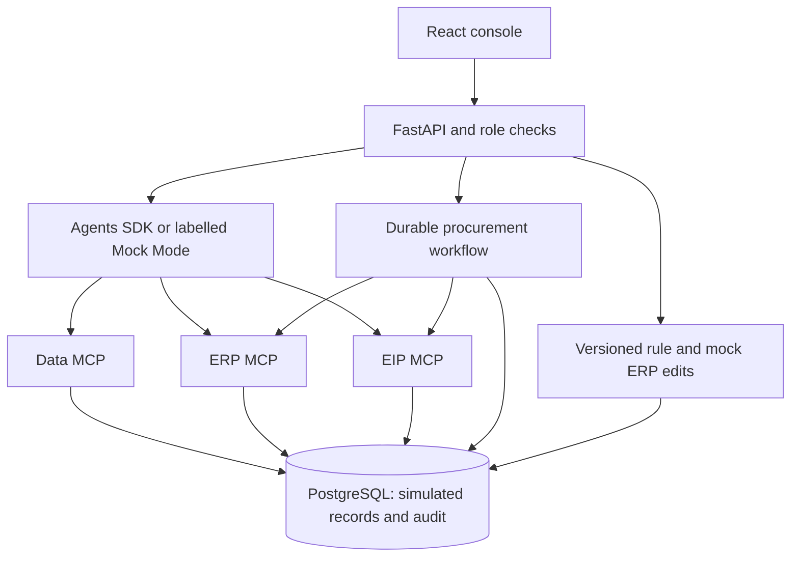

# Enterprise AI Operations Hub

A simulated manufacturing operations dashboard and procurement workflow. Data, ERP and EIP MCP tools run as stdio subprocesses; FastAPI checks credentials, mints short-lived signed MCP capabilities, and records tool calls in PostgreSQL. Mock Mode is deterministic and requires no paid LLM. The existing read-only chat can use Agents SDK Function Calling when configured. Procurement routing is deterministic, not a live multi-agent handoff. No real SAP or EIP connectivity.

## Run locally (developer setup)

This repository has no public demo deployment. The following steps run the system on your own computer; they do not provide a shareable site.

The planned public address is `https://ai.milespapa.com/`: its homepage lists AI projects, and the procurement simulation lives at `/operations/`. The Manufacturing Intelligence Platform currently links to its separate Tableau Public dashboard; a future `/manufacturing/` route is reserved as a plan, not a deployed application. DNS and hosting have not yet been provisioned.

1. `cp .env.example .env`. Replace all three `replace-with-...` secrets with independent random strings (minimum 24 characters for demo tokens; 32 for the signing key). Leave `OPENAI_API_KEY=` blank for Mock Mode.
2. Run `docker compose up --build --wait` to start the database, API, and UI locally.
3. Paste the `DEMO_ANALYST_TOKEN` or `DEMO_MANAGER_TOKEN` value from `.env` into the UI login field. Try “本月生產良率與品質異常”, “查詢 P-100 庫存”, “銷售營收”, or “簽核 1” with the manager token. The trace exposes tool name, input, computed output, and source.
4. In Workflow Console, enter “請評估採購 P-300”. Inventory 4, reorder point 20, and no unfulfilled orders yield a draft for 16 units. Sign in with the manager token, refresh, inspect the draft, click **人工確認並提交**, then **查詢 EIP 簽核**. The simulated EIP status is `pending`, not an approval. P-100 has an existing pending purchase of 50, so its calculated gap is zero.
   As manager, edit P-300 inventory to 10 in **模擬資料與採購規則**. The old 16-unit draft becomes stale; a new draft calculates 10. Preview the safety-stock template with 5 units, publish a new rule version, and create a new draft for 15. The original snapshot and rule ID remain in its event history.
5. `docker compose down` when done. Add `-v` only if you intend to remove the database volume.

For a local development run, use Python 3.12 and Node 22: `python -m venv .venv && .venv/bin/pip install -e '.[dev]'`, export the variables from `.env`, set `DATABASE_URL=sqlite:///./hub.db` for a local demo, run `.venv/bin/uvicorn backend.api:app --reload`; then `cd frontend && npm ci && npm run dev`. Docker Compose uses PostgreSQL. SQLite is supported for isolated local tests.

## Architecture

Each MCP server runs as a stdio subprocess (`python -m backend.mcp_servers.data`, `.erp`, `.eip`). The API calls them through the official MCP client. A single backend function computes the procurement gap for both draft and confirmation. Every draft stores a product revision and immutable rule ID; changes reject stale confirmations. The seeded enterprise records are synthetic.

## Security boundaries and limitations

- The bearer tokens are demo credentials configured by the operator. UI keeps the token only in React memory and sends it to the API; server signs a 120-second capability for MCP calls. MCP tools verify signature, active user, role, inputs, and log calls. Approval status is manager-only. Purchase submission is a separate, manager-only API transaction after explicit human confirmation; the LLM has no write tool or SQL execution tool.
- The developer Compose setup uses shared demo bearer tokens; **do not publish its ports**. The separate `deploy/compose.yaml` uses cookie-bound 24-hour visitor workspaces, isolated products/orders/rules/workflows, disabled shared tokens and chat, bounded per-workspace operations, and only exposes HTTPS through Caddy. The public demo cookie is scoped to `/operations/`. Visitors can switch simulated roles in their own workspace; this is not enterprise authentication. Public operation still requires origin-side protection against session creation floods, external backups, monitoring, and a hosting/security review. No public URL is deployed yet.
- LLM behavior and numerical quality in live chat mode require a real API key and separate evaluation. The Phase 04 procurement workflow uses deterministic routing and arithmetic even if a key exists; no live multi-agent LLM evaluation has been performed. The test suite exercises deterministic Mock Mode; passing it does not claim the live LLM was tested. Workflow state and events persist; existing chat remains stateless.

See [workflow design and demo](docs/workflow.md), [architecture](docs/architecture.md), and [deployment plan](docs/deployment.md).

## Verification

Backend: `pytest -q && ruff check backend tests && mypy backend --follow-imports=silent`. Frontend: `cd frontend && npm run build && npx playwright install chromium && npm run test:e2e`. GitHub Actions checks the developer Compose flow with real UI/API/MCP/PostgreSQL Playwright and the isolated public Compose flow with two browser visitors. Local Playwright needs a browser installation and a compatible desktop environment. See [API and MCP contracts](docs/contracts.md).
