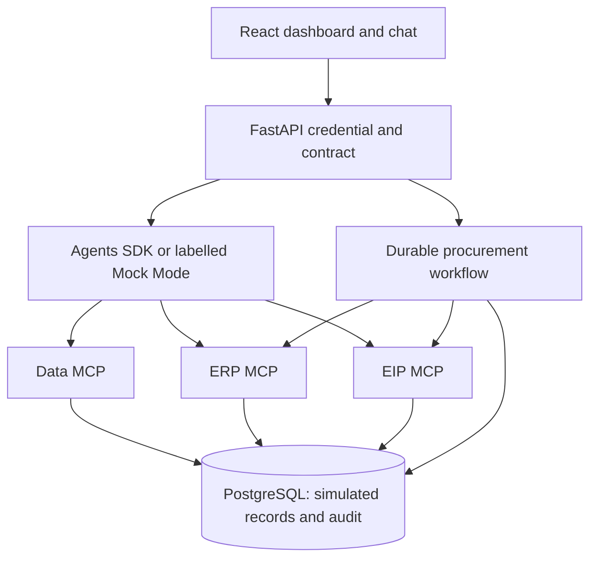

# Enterprise AI Operations Hub

A simulated manufacturing operations dashboard and agent demonstration. Three independent MCP servers expose Data, ERP, and EIP read-only tools; FastAPI checks a demo bearer credential, mints a short-lived signed MCP capability, and records each tool call in PostgreSQL. OpenAI Agents SDK Function Calling selects tools when `OPENAI_API_KEY` is set. Otherwise a clearly labelled deterministic Mock Mode invokes the same MCP servers. No real SAP or EIP connectivity.

## Run locally (developer setup)

This repository has no public demo deployment. The following steps run the system on your own computer; they do not provide a shareable site.

1. `cp .env.example .env`. Replace all three `replace-with-...` secrets with independent random strings (minimum 24 characters for demo tokens; 32 for the signing key). Leave `OPENAI_API_KEY=` blank for Mock Mode.
2. Run `docker compose up --build --wait` to start the database, API, and UI locally.
3. Paste the `DEMO_ANALYST_TOKEN` or `DEMO_MANAGER_TOKEN` value from `.env` into the UI login field. Try “本月生產良率與品質異常”, “查詢 P-100 庫存”, “銷售營收”, or “簽核 1” with the manager token. The trace exposes tool name, input, computed output, and source.
4. In Workflow Console, enter “請評估採購 P-300”. Inventory 4, reorder point 20, and no unfulfilled orders yield a draft for 16 units. Sign in with the manager token, refresh, inspect the draft, click **人工確認並提交**, then **查詢 EIP 簽核**. The simulated EIP status is `pending`, not an approval. P-100 has an existing pending purchase of 50, so its calculated gap is zero.
5. `docker compose down` when done. Add `-v` only if you intend to remove the database volume.

For a local development run, use Python 3.12 and Node 22: `python -m venv .venv && .venv/bin/pip install -e '.[dev]'`, export the variables from `.env`, set `DATABASE_URL=sqlite:///./hub.db` for a local demo, run `.venv/bin/uvicorn backend.api:app --reload`; then `cd frontend && npm ci && npm run dev`. Docker Compose uses PostgreSQL. SQLite is supported for isolated local tests.

## Architecture

Each MCP server runs as an independent stdio subprocess (`python -m backend.mcp_servers.data`, `.erp`, `.eip`). The API calls them through the official MCP client; Function Calling tools wrap those calls and keep signed credentials outside model context. SQLAlchemy performs the numerical calculations; the model is instructed to explain returned figures only. Every demo record is seeded once with stable IDs and dates from 2026-11-01 to 2026-11-02.

## Security boundaries and limitations

- The bearer tokens are demo credentials configured by the operator. UI keeps the token only in React memory and sends it to the API; server signs a 120-second capability for MCP calls. MCP tools verify signature, active user, role, inputs, and log calls. Approval status is manager-only. Purchase submission is a separate, manager-only API transaction after explicit human confirmation; the LLM has no write tool or SQL execution tool.
- This is a single-tenant demo: static demo tokens, a fixed demo policy, no enterprise SSO, migrations, rate limiting, or production-grade secrets management. Do not expose it publicly without stronger authentication, HTTPS, network restrictions, and production security review. Demo `.env.example` values are placeholders.
- LLM behavior and numerical quality in live chat mode require a real API key and separate evaluation. The Phase 04 procurement workflow uses deterministic routing and arithmetic even if a key exists; no live multi-agent LLM evaluation has been performed. The test suite exercises deterministic Mock Mode; passing it does not claim the live LLM was tested. Workflow state and events persist; existing chat remains stateless.

See [workflow design and demo](docs/workflow.md) for transitions, retry policy, and security boundaries.

## Verification

Backend: `pytest -q && ruff check backend tests && mypy backend --follow-imports=silent`. Frontend: `cd frontend && npm run build && npx playwright install chromium && npm run test:e2e`. GitHub Actions checks backend, frontend, and the Docker Compose API/MCP integration. See [API and MCP contracts](docs/contracts.md) for inputs and outputs.
