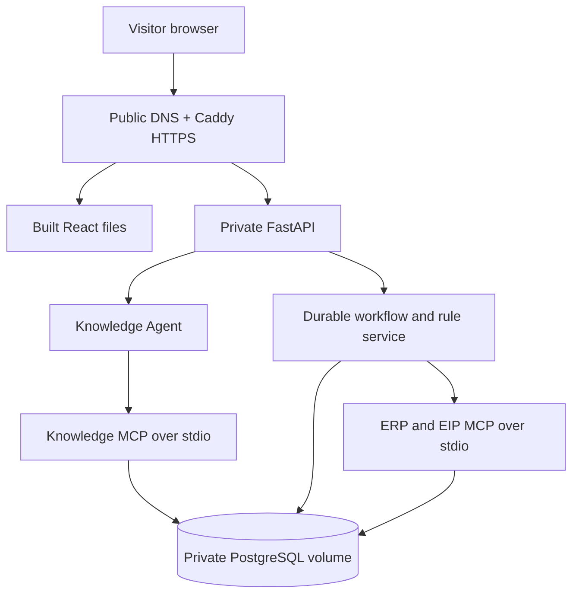

# Procurement demonstration architecture

- The public gateway exposes only HTTP/HTTPS for TLS and redirects. The API, database, and MCP subprocesses stay on the Docker private network. The frontend is built once and served as static files; the developer-only Vite server is not used in deployment.
- Knowledge documents, vector chunks and lookup audit records, synthetic ERP product/order records, visitor workspaces, versioned rules, before/after change history, task states, tool events, and pending EIP approvals are stored in PostgreSQL on the server volume, never on a visitor's computer or in GitHub. Back up the volume to separate storage before running a public instance.
- The API holds the signed HttpOnly SameSite cookie and maps it to one isolated workspace. The public mode never accepts the developer bearer tokens. The browser can switch between simulated analyst and manager in *its own* workspace. This is an educational role simulation, not proof of an enterprise identity provider.
- MCP tools verify a signed 120-second capability and resolve a public SKU inside that workspace. They cannot read another workspace's orders or EIP approvals. Chat and aggregate dashboard endpoints are disabled in public mode so global seeded analytics cannot leak between workspaces.
- A rule is an immutable published version selecting one of two bounded, audited templates. Admins cannot submit arbitrary Python or SQL. Each draft records the product revision and rule version; confirmation rechecks both and calculates the quantity again inside a transaction. Duplicate confirmation returns the same submitted identifiers.
- Expired 24-hour sessions are removed in bounded batches when new sessions start. Quotas limit products, orders, rules and workflows per workspace; the server also caps active workspaces. Add edge request throttling and monitoring before inviting broad public traffic.

The deterministic procurement path calls real MCP tools but the Data/Procurement labels are workflow stages rather than separately executing LLM agents. Independent long-running HTTP MCP containers from PR #3 remain optional and are not required for this deployment.

## Knowledge route

FastAPI routes Mock Mode policy questions and explicit knowledge requests to a read-only Knowledge MCP subprocess. It verifies the capability and filters current, authorized corpus rows before pgvector scoring. Optional AI selection sees only those allowed passages. Both the answer and citations are assembled from the same returned excerpts. Public sessions can search the shared synthetic corpus in Mock Mode. See the [RAG design](rag.md) for versioning, retrieval scoring, and the permissions matrix.

## Developer LLM orchestration

Developer chat uses a single Agents SDK agent when configured with an API key. The model chooses among Data, ERP, EIP and Knowledge tools over multiple turns. Every read crosses the existing MCP capability boundary. A separately authorized draft request passes to the deterministic workflow after ERP and SOP evidence are present. The server records bounded execution metadata in PostgreSQL and returns a run ID, citations, and the workflow result to the caller. See the [Operations Agent demo](agent.md).

The manual Phase 06B evaluator enters the same orchestration through `respond()`, seeds a temporary SQLite database, and uses the real stdio MCP subprocesses and draft workflow. Its OpenAI HTTP client reserves a worst-case charge and token count before each standard text request, then reconciles provider-reported usage. It stops on unknown usage or a provider failure and emits a report with case IDs, tool names, fixed outcomes, usage and timing. Normal CI exercises the budget gate with a test transport. See [Live Agent verification](live-agent-verification.md).
